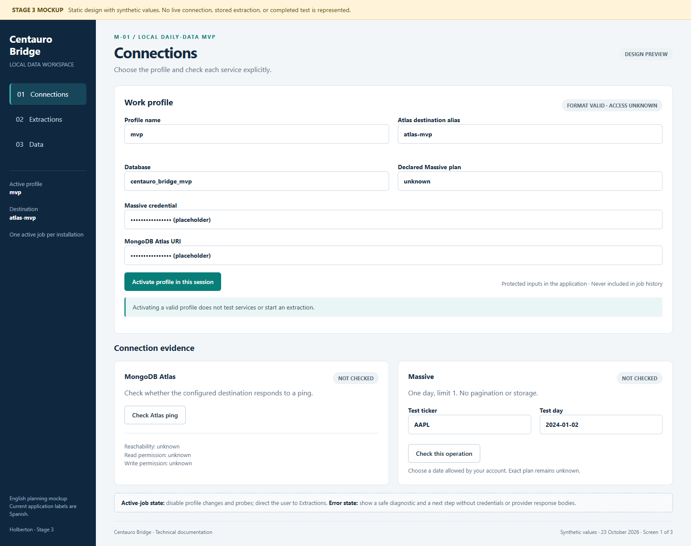
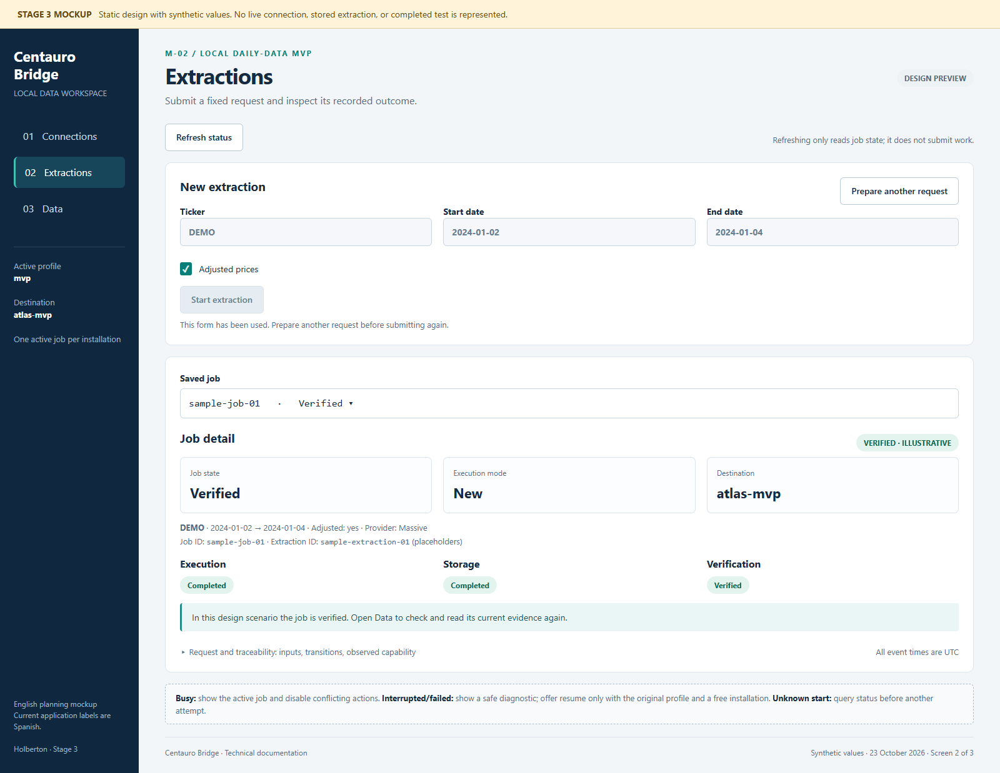
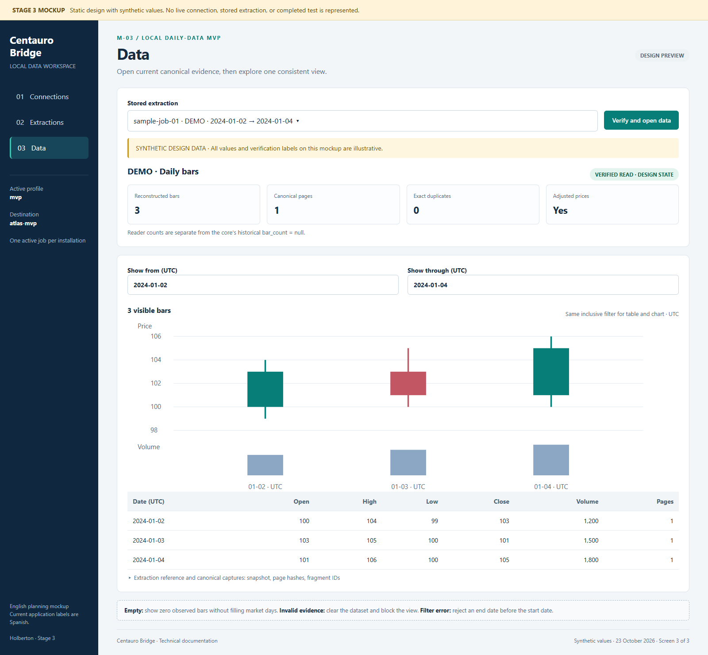

# Task 0 — Define User Stories and Mockups

**Project:** Centauro Bridge · **Stage:** 3 · **Version:** 1.0

## Users and priorities

The primary user is a student or data researcher running the application on
their own computer. The operator configures the provider and database; one
person may perform both roles. A maintainer supports installation and recovery.
This MVP does not provide public accounts or a multiuser service.

MoSCoW priorities describe the MVP release: **Must Have** is necessary for
acceptance; **Should Have** is valuable but can be deferred with a documented
workaround; **Could Have** is optional; **Won't Have** is explicitly outside
this release. Existing code coverage does not by itself mark a story accepted.

## Prioritized stories

| ID | Priority | User story |
| --- | --- | --- |
| US-01 | Must Have | As an operator, I want to activate a provider and Atlas profile with protected credential fields, so that each request uses the intended destination without exposing secrets in job history. |
| US-02 | Must Have | As a researcher, I want to request daily OHLCV bars for a ticker and date range, so that I can collect a small, reproducible dataset. |
| US-03 | Must Have | As a researcher, I want to see execution, storage, and verification separately, so that I know whether data is actually ready to inspect. |
| US-04 | Must Have | As an operator, I want a second simultaneous request to be rejected as busy, so that this installation cannot run overlapping ingestion workers. |
| US-05 | Must Have | As an operator, I want to resume an interrupted or failed job against its original destination, so that I can recover progress without changing the request. |
| US-06 | Must Have | As a researcher, I want repeated completed requests to reuse verified stored evidence, so that I avoid unnecessary downloads and duplicate stored records. |
| US-07 | Must Have | As a researcher, I want data to be verified again when I open it, so that missing or altered evidence cannot silently enter my analysis. |
| US-08 | Must Have | As a researcher, I want one date filter to control both the table and chart, so that the two views describe the same bars. |
| US-09 | Should Have | As an operator, I want small connection checks before extraction, so that I can distinguish a valid profile from observed service access. |
| US-10 | Should Have | As a maintainer, I want a CLI that uses the same job lifecycle as the dashboard, so that I can inspect and recover work from a terminal. |
| US-11 | Could Have | As a first-time user, I want to explore clearly labeled synthetic data, so that I can learn the interface without service credentials. |
| US-12 | Won't Have | As a researcher, I want real-time feeds and additional data providers, so that I can explore more markets. |
| US-13 | Won't Have | As an investor, I want automated predictions and broker execution, so that I can automate trading decisions. |
| US-14 | Won't Have | As a team administrator, I want shared accounts, queues, scheduled jobs, and workers on multiple machines, so that many users can work concurrently. |

US-09 through US-11 already have implementation support. Their priority reflects
importance to acceptance, not a claim that they have yet to be implemented.
US-12 through US-14 are deliberately excluded, along with cancellation and
large historical downloads.

## Acceptance criteria

| Story | Observable acceptance criteria |
| --- | --- |
| US-01 | Given no active job, a syntactically valid profile can be activated. Invalid names, URI, or missing credentials are rejected. Public job JSON contains neither API key nor connection URI. Profile changes are disabled while a job is active. Activation does not start a job or prove access. |
| US-02 | Given valid service access, submit a valid uppercase ticker, ordered ISO dates, and an explicit adjusted flag. Receive an accepted receipt with IDs; invalid dates or ticker syntax produce safe feedback without starting ingestion. Run the two small, distinct-ticker requests specified in charter objective 1. |
| US-03 | After acceptance, refresh shows the recorded request and transitions through preparing, executing, verifying, and a final state. A failed verification never appears as a verified success even if execution completed. Reopening the UI does not erase the persisted job. |
| US-04 | While a worker holds the installation lock, another CLI/UI submission returns busy without starting a second ingestion. The active ID is included when available. Refreshing the dashboard alone creates no job. |
| US-05 | After a controlled worker interruption, a status read recognizes a confirmed dead worker. Resume with the original public profile and request creates a new job ID, preserves the extraction ID, and links resumed_from. A different destination or an ineligible state is rejected. |
| US-06 | Repeat a completed request against the same database. Record mode reused, verify stored evidence, and compare raw document IDs/counts before and after; no duplicate raw records are added. Reuse does not claim current provider access. |
| US-07 | Valid canonical evidence opens successfully. A missing fragment, changed payload, incompatible same-time OHLCV values, or mismatched profile blocks the read and shows a safe diagnostic. A legitimate empty extraction shows an empty state without invented bars. |
| US-08 | Apply inclusive UTC date boundaries. Every candle, volume bar, and table row comes from the same filtered frame. A reversed range shows an error. A range with no observations shows zero rows. Both volunteer sessions meet charter objective 2. |
| US-09 | Atlas ping reports reachability only; read/write permission stays unknown. The Massive check requests one day with limit 1, follows no pagination, and writes no data. A failed check exposes no response body or credentials. |
| US-10 | CLI start/status/jobs/resume use the same state directory and lock as the UI. Accepted/busy/error JSON and documented exit codes agree with the outcome. |
| US-11 | Demo mode visibly says synthetic/test data, requires no profile, creates no jobs, and makes no provider/Atlas calls. |

## Main-screen mockups

These medium-fidelity mockups are an English planning view of the current
Spanish dashboard. They use synthetic examples and masked placeholders. They
are not evidence that real requests succeeded. Buttons depict actions but do
not submit requests. Sidebar links navigate between the three HTML screens.

### M-01 — Connections

[Open editable HTML](mockups/01-connections.html). Supports US-01 and US-09.
The user activates a profile, then explicitly chooses either Atlas ping or a
one-day Massive probe. The connection cards distinguish unknown capability
from demonstrated reachability. With an active job, profile/probe controls are
disabled and the user is directed to Extractions.

### M-02 — Extractions

[Open editable HTML](mockups/02-extractions.html). Supports US-02 through US-06
and US-10. The form contains ticker, dates, and adjusted prices. A job selector,
explicit refresh, IDs, safe diagnostic, and three independent phase indicators
make progress visible. Only a failed/interrupted job can offer resume, and it
requires the original profile and a free installation. After uncertain startup,
the user must query status before preparing another request.

### M-03 — Verified data

[Open editable HTML](mockups/03-data.html). Supports US-07, US-08, and US-11.
The user selects a stored extraction and explicitly verifies/opens it. The
summary reports reader counts and provenance. The inclusive UTC date filter
feeds both views. The three synthetic rows in this mockup match the three
candles and volume bars. The historical core count remains separate.

## Interaction and state map

Connections → activate profile → Extractions → submit → refresh until finished
→ Data → verify/open → filter → inspect chart and table. A failed job returns
to its diagnostic/resume flow; an invalid read stays blocked in Data.

| Situation | Required screen behavior |
| --- | --- |
| No profile | Explain setup and disable submission; allow synthetic demo. |
| Invalid form | Identify the field category without echoing secrets; retain safe values. |
| Busy | Disable conflicting controls; show current work and refresh action. |
| Loading | Show a spinner for the current operation; never imply it finished. |
| Unknown worker start | Show reconciliation action; do not automatically resubmit. |
| Failed/interrupted | Show a safe next step; allow eligible resume after preparing another request. |
| Verified but empty | Explain zero observed bars; do not fill missing market days. |
| Invalid or changing evidence | Clear the opened dataset; block chart/table for that read. |
| Demo | Persistently identify synthetic values; provide exit-demo navigation. |

Use text labels as well as color for status, visible input labels, readable
contrast, and a table alternative to the chart. Keyboard order and narrow-screen
behavior are manual QA targets, not accessibility certification.

## Review and traceability

Charter objective 1 maps to US-01, US-02, US-03, and US-07; objective 2 maps to
US-07 and US-08; objective 3 maps to US-04 through US-07. See the
[QA evidence matrix](scm-and-qa.md#2-quality-assurance-plan) for test ownership,
examples, and release gates. Anthony owns the draft; the peer/mentor reviewer
and volunteer users remain to be confirmed. No team approval or usability
session is claimed by this document.
