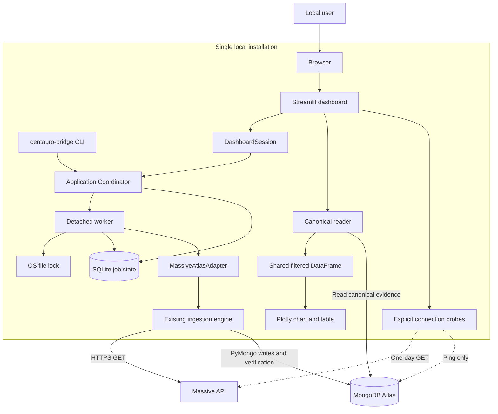

# Centauro Bridge — Technical Documentation

**Stage:** 3 · **Version:** 1.0 · **Prepared:** 23 October 2026

**Owner:** Anthony (`anthocab2`) · **Review:** peer/mentor review pending

## 1 Purpose, scope, and baseline

Centauro Bridge helps students and researchers request daily OHLCV market data,
store traceable captures in MongoDB Atlas, and explore verified bars locally.
OHLCV means open, high, low, close, and volume. The blueprint follows the
[Stage 2 charter](../stage_2/PROJECT_CHARTER.md): one operator, one provider,
one Atlas destination per job, and one active worker per installation.

The source baseline is public `main` at `4909630a22d72b7a77990a0e7ac598777f4bf08c`.
It already includes Python application logic, a CLI, Streamlit, recovery, and a
canonical reader. This document describes that implementation and proposes its
acceptance/maintenance process. It does not claim successful live service
validation. No application behavior is changed by this documentation delivery.

Real-time data, predictions, trading, brokers, public hosting, multiuser
authentication, distributed locking, cancellation, and scheduling are outside
the MVP. A custom HTTP API is also outside the current implementation.

## 2 User stories and mockups

The [Task 0 document](0-user_stories_and_mockups.md) defines 14 MoSCoW stories,
observable acceptance criteria, and three main-screen mockups. The primary
journey is profile → request → status → verified read → shared date filter.

| Charter target | Technical support | Acceptance evidence |
| --- | --- | --- |
| Two small verified extractions by Week 2 | Immutable request/profile; worker; Massive adapter; Atlas verification | Two distinct supported tickers, each at most five trading days, both verified, at least one nonempty |
| Two independent users explore data by Week 3 | Connections/Extractions/Data screens; canonical reader; shared filtered frame | Each user completes open/filter within ten minutes after setup, using only the guide |
| Four reliability scenarios by Week 4 | Installation lock; recovery; idempotent writes; verification on read | Busy rejection, interrupted resume, completed reuse, tampered/incomplete-read rejection |

The weeks are relative to a start date agreed with the reviewer. They are not
completed milestones or assigned calendar deadlines.

## 3 System architecture

[SVG diagram](diagrams/architecture.svg) · [Editable Mermaid](diagrams/architecture.mmd)

The browser talks to the local Streamlit application. DashboardSession holds
presentation state and delegates job lifecycle operations to the same
Coordinator used by the CLI. The Coordinator launches a separate worker and
returns an acceptance receipt. The worker owns the file lock for its lifetime,
writes safe job state to SQLite, and calls the existing ingestion engine through
a thin adapter. That engine is the only production raw-data writer.

The engine calls Massive over HTTPS and writes captures, page identities,
checkpoints, and runs to Atlas. The reader uses a separate explicit Atlas client
and reconstructs only the canonical documents identified by the page ledger.
A single filtered DataFrame supplies both chart and table. Probes are explicit,
small operations; they do not launch extraction jobs or prove more than their
stated scope.

### Deployment and trust boundaries

- **Runtime:** Python `>=3.11,<3.12`; install the versions recorded in `uv.lock`
  using `uv sync --locked --python 3.11`.
- **Local UI:** use `uv run streamlit run dashboard.py --server.address 127.0.0.1`
  and open the loopback address. This plan does not expose Streamlit publicly.
- **State:** use one stable, local state directory shared by CLI and dashboard.
  SQLite and the OS lock coordinate this installation, not other machines.
- **Secrets:** configure protected dashboard fields or environment variables
  referenced by the public TOML profile. Never put real values in Git, examples,
  screenshots, or job documents. Protected fields are not an encrypted vault.
- **Network:** Massive access uses HTTPS and an authorization header. Atlas uses
  PyMongo and the configured URI; require the intended TLS-enabled Atlas URI and
  keep certificate validation enabled for acceptance. A valid URI alone does
  not prove network access, authentication, or write permission.
- **Credentials in memory:** the explicit profile and worker environment hold
  secrets for their runtime lifetime. The operating-system account is trusted;
  this is not isolation from another process running as that user.

## 4 Components, classes, and data design

[Data design](data-design.md) specifies Request/Profile, Coordinator, State,
DashboardSession, adapter, immutable reader objects, SQLite DDL, and four Atlas
collection structures with indexes. It includes class and relationship diagrams.

The distinction between **job** and **extraction** is central: every accepted
attempt gets a new random job ID, while an identical logical request gets the
same deterministic extraction ID. Resume links the attempts; the storage ledger
identifies which captured fragments are canonical. SQLite records the local
workflow; Atlas stores the extraction evidence.

## 5 Interactions and API specifications

[Sequence diagrams](sequence-diagrams.md) cover accepted/busy submission,
interruption/resume/reuse, and verified reading with error paths.
[API specifications](api-specifications.md) define Massive requests, Atlas
operations, connection probes, Python contracts, CLI JSON, exit codes, and safe
diagnostics. There are no application-owned REST endpoints to document: the
internal interfaces are Python calls and the CLI. Streamlit's transport is an
implementation detail, not a supported business API.

## 6 Source control and QA

[SCM and QA](scm-and-qa.md) defines short-lived branches, review expectations,
reproducible dependency installation, automated test layers, manual scenarios,
evidence recording, and release/rollback gates. Repository protections and CI
automation are proposed controls, not claimed as enabled by this submission.

The existing validation report is historical. Live Massive/Atlas validation and
the two volunteer sessions remain pending. Documentation checks for this change
are recorded separately in [validation](validation.md).

## 7 Technical justifications

| Decision | Requirement served | Reason and tradeoff |
| --- | --- | --- |
| Python 3.11 and locked dependencies | Maintain the working core with a repeatable environment | Matches `pyproject.toml` and existing engine. Adding another backend language would increase integration work; newer Python versions are not within the declared support range. |
| Local Streamlit UI | Let two volunteers request and inspect data with little setup | Reuses Python components and provides forms, tables, and charts. Reruns require explicit action tokens; browser session state is not durable job storage. |
| Shared core for CLI and UI | Consistent status and recovery | Both callers delegate to Coordinator and State. UI code does not become a second ingestion pipeline. |
| Detached worker and local lock | Continue accepted work after the caller closes; reject overlap | Worker owns the lock and receives fixed configuration. Simpler than a queue service, but limits concurrency to one installation and has no cancellation. |
| SQLite for local jobs | Durable history with no extra local database service | Transactions and a partial unique index constrain active jobs. It does not coordinate different state directories or hosts. |
| Atlas document collections | Preserve provider payloads, fragments, and provenance | Retains the existing engine and flexible JSON-shaped captures. Requires network access and authorized storage; this is not an offline data warehouse. |
| Hashes, ledger, and checkpoints | Reuse and recover without silently mixing captures | Separates captured bytes, canonical page selection, and progress. Hashes detect inconsistencies against stored evidence; they do not authenticate the market provider or protect against an attacker rewriting every related record. |
| Verification at read time | Block altered or incomplete evidence | Historical success is insufficient. The reader validates the exact loaded documents, then rereads run/ledger metadata; this costs extra reads and is not a transactional cross-collection snapshot. |
| pandas + Plotly | Keep table and chart consistent | A single filtered frame drives candles, volumes, and rows. The reader loads data into memory, so the MVP intentionally uses small ranges rather than claiming large-scale throughput. |
| No custom HTTP API | Keep a local single-user MVP manageable | Python/CLI contracts meet present callers. REST, account management, and remote deployment add scope without serving the agreed acceptance targets. |

Streamlit documents per-session state across reruns and provides AppTest for
headless input/output testing; those capabilities support the chosen UI and QA
approach ([Session State](https://docs.streamlit.io/develop/api-reference/caching-and-state/st.session_state),
[App testing](https://docs.streamlit.io/develop/api-reference/app-testing)).
SQLite supports unique indexes restricted to rows matching a predicate, which
fits the active-job invariant ([Partial indexes](https://www.sqlite.org/partialindex.html)).
The proposed branch/review lifecycle follows
[GitHub flow](https://docs.github.com/en/get-started/using-github/github-flow).
These sources support design choices; project behavior is established by the
linked source files, not by assuming every library capability is implemented.

## 8 Remaining validation and review decisions

1. Confirm the reviewer, two volunteers, start date, supported tickers, and
   account-permitted date ranges in Week 1.
2. Establish authorized connectivity and a dedicated disposable validation
   database. A ping is not evidence of successful ingestion.
3. Execute the acceptance matrix and save redacted results; resolve failures
   before marking charter targets complete.
4. Review the mockups against the actual Spanish interface, keyboard flow, and
   empty/error states. Record any agreed UI changes as separate work.
5. Review the provider contract gap: the current adapter requires a `results`
   list, while provider documentation permits optional response fields. Test the
   empty-response shape for the permitted operation before relaxing validation.
