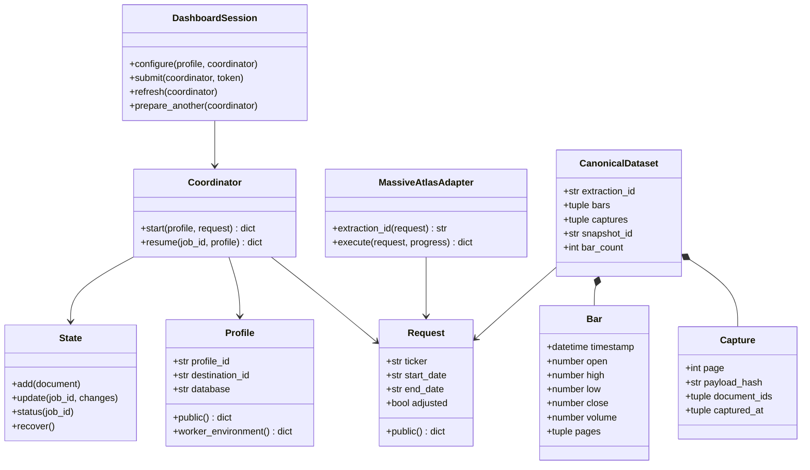
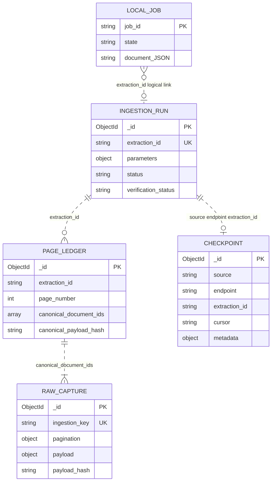

# Components, Classes, and Database Design

## 1 Component responsibilities

Paths below are relative to the repository root. Follow the links to the
implementation used for this design.

| Component | Responsibility and boundary |
| --- | --- |
| [application/models.py](../../src/centauro_atlas_bridge/application/models.py) | Immutable validated Request/Profile; safe public serialization; explicit worker environment. |
| [application/coordinator.py](../../src/centauro_atlas_bridge/application/coordinator.py) | Launch worker, wait for a receipt, validate resume eligibility; does not store raw payloads. |
| [application/worker.py](../../src/centauro_atlas_bridge/application/worker.py) | Own installation lock, create attempt, call adapter, persist safe transitions and final outcome. |
| [application/state.py](../../src/centauro_atlas_bridge/application/state.py) | Versioned SQLite jobs, OS file lock, process identity checks, interrupted-worker recovery. |
| [application/adapter.py](../../src/centauro_atlas_bridge/application/adapter.py) | Preserve the existing engine as writer; classify mode and require verification. |
| [sources/massive.py](../../src/centauro_atlas_bridge/sources/massive.py) and [ingestion](../../src/centauro_atlas_bridge/ingestion/) | Provider validation, pagination, bounded retries, chunking, idempotent persistence, checkpoints and evidence verification. |
| [dashboard/session.py](../../src/centauro_atlas_bridge/dashboard/session.py) | Session profile, one-use submission token, selected job, startup reconciliation; delegates lifecycle to core. |
| [reading/canonical.py](../../src/centauro_atlas_bridge/reading/canonical.py) | Read selected canonical fragments, verify exact evidence, validate/deduplicate bars, return immutable dataset. |
| [dashboard/presentation.py](../../src/centauro_atlas_bridge/dashboard/presentation.py) | Convert dataset to one UTC-filtered DataFrame, then render candles/volume and table. |

## 2 Main classes and values



[SVG](diagrams/classes.svg) · [Mermaid source](diagrams/classes.mmd)

Request and Profile are frozen dataclasses. Profile also holds secret API-key
and URI fields excluded from its repr and public representation. A profile is
not a database user table. DashboardSession is mutable presentation state; it
does not own the durable job lifecycle. Worker code is a module/process, not a
Worker class. The canonical reader exposes functions rather than a reader class.

CanonicalDataset, Bar, and Capture are frozen dataclasses. Dataset also includes
the request, destination fingerprint, exact duplicate count, read timestamp, and
provider. Bars carry timezone-aware UTC timestamps and source page numbers;
Capture links a page to its hash and fragment IDs. These are reconstructed
in-memory values, not additional MongoDB collections.

## 3 Storage relationships



[SVG](diagrams/data-relationships.svg) · [Mermaid source](diagrams/data-relationships.mmd)

Dashed relationships are logical links enforced by application validation,
not SQL foreign keys across systems. A local job may fail before an Atlas run
exists. Many local attempts can refer to one extraction. A run can have no
pages/checkpoint yet; a committed canonical page references one or more raw
fragments. Raw storage can also contain alternate captures not selected by a
ledger. The reader excludes those alternates.

## 4 SQLite schema and job document

`jobs.sqlite3` lives in the stable installation state directory, outside the
checkout. The current schema is version 1:

```sql
CREATE TABLE IF NOT EXISTS jobs (
    job_id TEXT PRIMARY KEY,
    state TEXT NOT NULL,
    document TEXT NOT NULL
);
CREATE UNIQUE INDEX IF NOT EXISTS one_active ON jobs((1))
WHERE state IN ('preparing', 'executing', 'verifying');
PRAGMA user_version = 1;
```

`document` contains JSON, including these groups:

| Group | Fields and types |
| --- | --- |
| Identity | schema_version: integer; job_id: UUID hex string; extraction_id: SHA-256 hex string; resumed_from: job ID or null |
| Fixed input | profile: safe public object; request: ticker/start_date/end_date strings and adjusted boolean |
| Lifecycle | state, execution_status, storage_status, verification_status: strings; mode: string or null |
| Audit | created_at/updated_at: UTC ISO strings; finished_at: UTC ISO string or null; events: list of state/at objects |
| Process | worker: process identity containing PID, creation time, and random token |
| Outcome | result: object or null; diagnostic: safe object or null; capability: observed status/scope/exact_plan |

Job states are preparing, executing, verifying, verified, failed, interrupted.
Execution can be completed even when verification fails. The partial index
permits at most one active row. The independent OS lock in `worker.lock`
protects the worker lifetime; lock ownership does not transfer between caller
and worker. Unknown process visibility is treated conservatively, not as proof
that the worker died. Unknown future SQLite schema versions are rejected rather
than overwritten. There is no network/distributed lock.

## 5 Atlas collection structures and indexes

The configured database contains four engine collections. MongoDB supplies
`_id`; timestamps written by the engine are UTC datetimes. No MongoDB schema
validator is installed by these modules: shape and integrity validation are in
application code. The table describes the fields relevant to the MVP, including
fields added as a run progresses.

| Collection | Principal fields | Indexes created by the engine |
| --- | --- | --- |
| raw_ingestion | ingestion_key:string; source:string; endpoint:string; parameters:object; extracted_at:datetime; payload_hash:string; original_payload_hash:string for chunked storage path; pagination:object; payload:object | Unique ingestion_key; nonunique (pagination.extraction_id, pagination.page_number, pagination.chunk_number) in chunk storage |
| ingestion_runs | extraction_id:string; source:string; endpoint:string; parameters:object; status:string; started_at/updated_at:datetime; completed_at:datetime when complete; pages_stored:integer when complete; error:string or null; verification_status:string; verification_errors:array; verification_checked_at:datetime or null | Unique extraction_id |
| ingestion_page_ledger | extraction_id:string; page_number:integer; source/endpoint:string; canonical_payload_hash/canonical_content_hash:string; canonical_document_ids:array of string IDs; canonical_chunk_count/canonical_record_count:integer; created_at/updated_at:datetime; capture_count:integer; observed_payload_hashes/observed_content_hashes:arrays | Unique (extraction_id, page_number) |
| ingestion_checkpoints | source/endpoint/extraction_id:string; cursor:string or null; metadata:object with completed:boolean and last_page:integer; updated_at:datetime | Unique (source, endpoint, extraction_id) |

All collections also have MongoDB's `_id` index. A raw pagination object
identifies the extraction, page, chunk number, total chunks, and storage mode.
Raw payload metadata and its `results` array preserve the captured provider
response. Pagination URLs are sanitized before they become stored evidence.
The canonical ledger's first selected capture is retained; later observed
captures are tracked, not silently substituted.

### Identity and idempotency

- **extraction_id:** SHA-256 of the sorted, compact JSON object containing
  ticker, start_date, end_date, and adjusted. It does not include credentials or
  destination; the public profile fingerprint separately binds the target.
- **destination_fingerprint:** SHA-256 of the normalized host/port portion and
  database, excluding credentials and URI query options. This is a matching
  aid, not proof of server identity.
- **ingestion_key:** deterministic hash of source, endpoint, parameters, payload
  hash, pagination, and optional fragment identifier. Unique-index upserts with
  `$setOnInsert` prevent inserting the same stored fragment twice.
- **payload/content hashes:** distinguish the full captured payload from the
  page's results. Fragmented payloads retain the original payload hash.

### Write and read invariants

For each fetched page, the engine stores raw fragments, registers the canonical
page, then saves progress. Completion and integrity verification are separate
steps. Because this is not one cross-collection transaction, recovery examines
existing evidence after a crash. A completed checkpoint is never enough on its
own to trust data. The chunker targets an 8,000,000-byte payload budget and
rejects an unsplittable oversized result rather than silently truncating it.

On read, the profile/request/extraction identity must match; the run and page
ledger must agree with the fragments; page and fragment coverage and hashes must
verify. The reader requires finite numeric OHLCV values, nonnegative volume,
consistent high/low bounds, and integer timestamps. Identical same-time bars are
deduplicated while their page provenance is combined. Conflicting values at the
same timestamp fail the read. Output is sorted in UTC. Missing market days are
not filled. Run and ledger metadata are read again before returning to detect
changes during reconstruction; this is not a database snapshot transaction.

## 6 Retention and evolution plan

The MVP has no automatic retention or destructive cleanup feature. Keep raw
captures, their ledger, runs, and checkpoints together for repeatable validation.
Use a dedicated disposable database for destructive QA fixtures. Changes to
identities, hashes, or persisted shapes need a migration/backward-compatibility
review and recovery tests; do not drop collections or reset SQLite to make an
upgrade appear successful. Backup/retention procedures beyond this small MVP
remain operational decisions for the authorized database owner.
