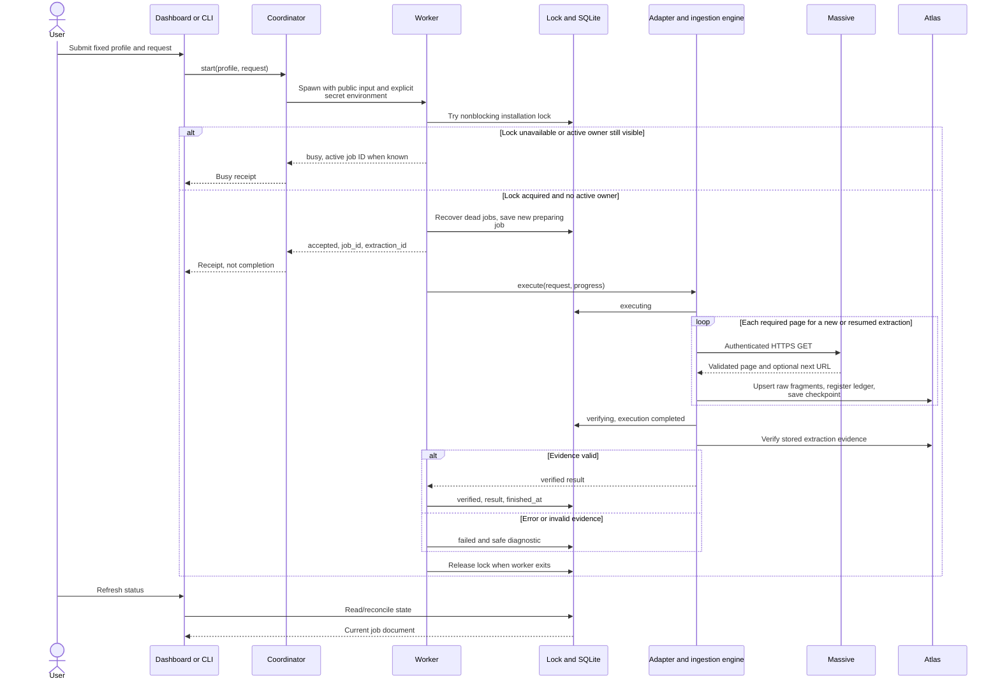
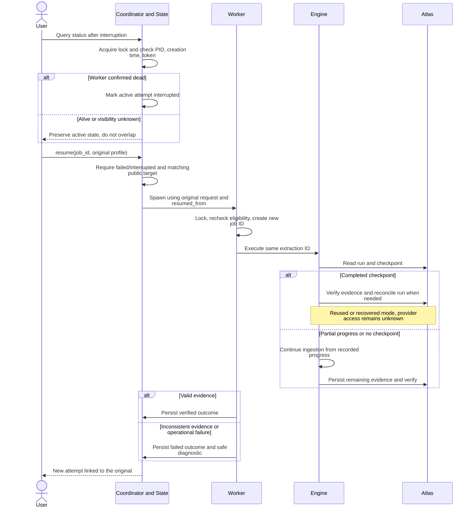
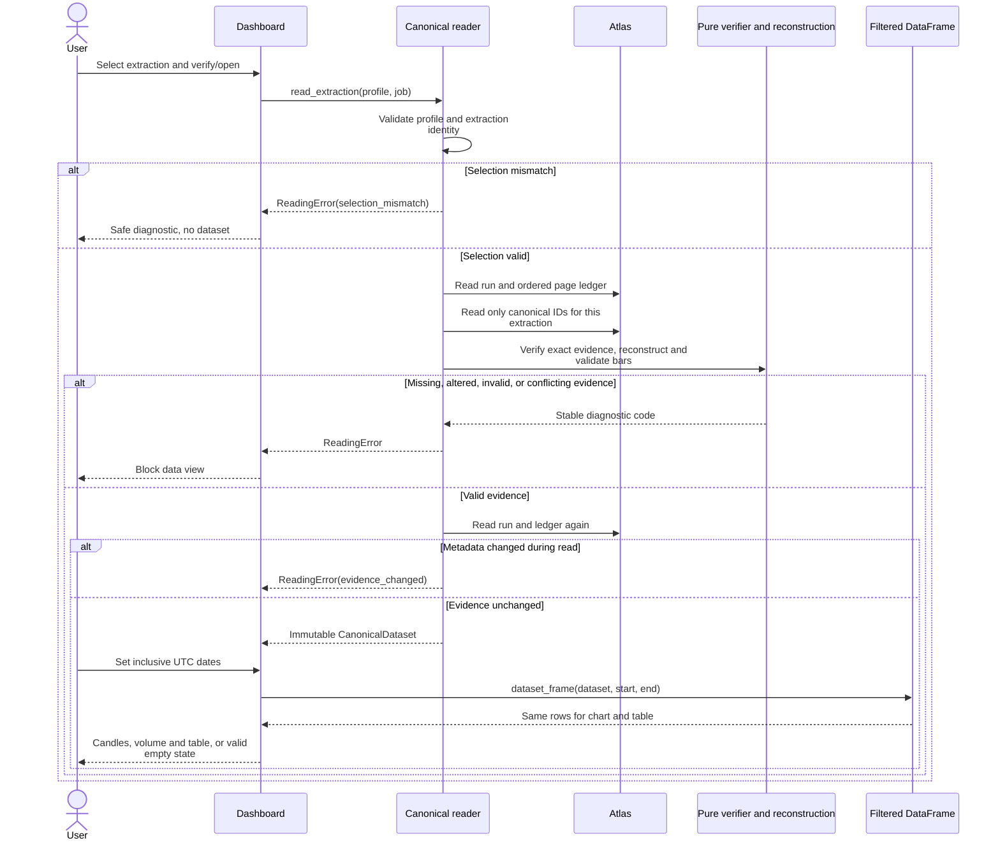

# High-Level Sequence Diagrams

These diagrams describe the current local MVP. Arrows to Atlas may represent
several driver operations; they do not imply one atomic transaction.

## 1 Submit, reject overlap, and observe completion

[SVG](diagrams/submission.svg) · [Mermaid source](diagrams/submission.mmd)

The caller receives acceptance before extraction finishes. The detached worker
continues after the caller closes. The worker holds the same installation lock
through the job. Dashboard submission tokens prevent reruns from resubmitting;
the core lock also covers competing CLI processes. A missing receipt after the
Coordinator's wait produces `worker_start_unknown`, not proof of failure: query
jobs before trying again. The loop depicts new/resumed fetching; a completed
request can follow the reuse path below without a new provider download.

## 2 Resume, reuse, and recovery

[SVG](diagrams/recovery.svg) · [Mermaid source](diagrams/recovery.mmd)

Resume creates a new attempt with the same extraction identity and fixed
request. Renewed credentials are permitted only when the public target still
matches. The engine determines mode from Atlas evidence. An ordinary repeated
`start` for a completed request reaches the same completed-checkpoint branch;
it does not require `resume`. Verification failure is never silently repaired
by declaring success; investigate the evidence before retrying.

## 3 Open verified data and filter both views

[SVG](diagrams/verified-read.svg) · [Mermaid source](diagrams/verified-read.mmd)

The dashboard clears the prior dataset when opening another job or starting a
new read. Driver/connection failures map to `read_failed`; no raw exception or
credentials reach the view. A historical verified job still needs a fresh
reader check. The reader does not write data or refresh historical bar counts.
An empty but valid result returns an empty dataset with provenance, not an error.
