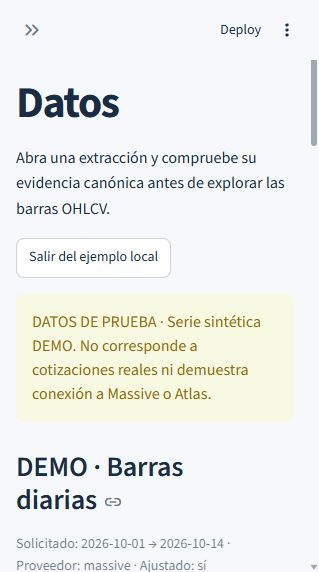
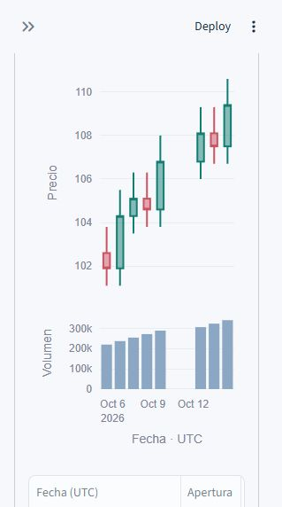

# Validación de Centauro Bridge

Fecha local: 22 de octubre de 2026. Entorno propio de Codex: Windows, CPython 3.11.15, dependencias fijadas en `uv.lock`. HBT-CEN-002 no se ejecutó en Linux durante esta entrega.

## HBT-CEN-002 — ejecución propia de Codex

`uv sync --locked --python 3.11` aprobado. Suite completa: **190 passed, 6 skipped**. Ruff aprobado. Revisión de espacios `git diff --check` aprobada. Son las 140 pruebas anteriores y 50 casos nuevos. Las seis omisiones siguen siendo integraciones Atlas, no fallos ocultados ni pruebas del lector omitidas.

| Criterio | Evidencia ejecutada |
| --- | --- |
| Páginas y chunks | Reconstrucción con varios fragmentos, hashes originales, orden UTC y procedencia conservada |
| Canonicidad | Capturas alternativas excluidas aun si se entregan al reconstructor; consultas raw limitadas a IDs del ledger |
| Selección | Perfil, clúster, base, proveedor, solicitud e identidad incompatibles rechazados antes de crear el cliente |
| Integridad actual | Payload alterado, fragmento ausente, conflictos, hashes, run inválido/fallido, chunks y cambios de run/ledger durante lectura rechazados |
| Barras | Vacío válido, duplicados exactos con páginas de origen, conflicto OHLCV, números inválidos, timestamp UTC, conteo y orden |
| Sin efectos de lectura | Colecciones MongoDB simuladas y entorno sin cambios; conteo histórico conserva null |
| Tabla y gráfico | Mismo DataFrame filtrado; timestamps, OHLCV y volumen de ambas trazas coinciden; no se rellenan huecos |
| Conexiones | Ping sin afirmar escritura; una petición Massive acotada, respuesta vacía válida y errores 401/403/429 seguros |
| Sesión y trabajos | Streamlit AppTest: reruns/consulta/doble envío sin nuevos inicios, trabajo en SQLite visible en nueva sesión, perfil bloqueado durante ejecución, inicio incierto reconciliado y reanudación única |
| Lectura en UI | Lectura sólo por botón, reruns reutilizan snapshot, un fallo posterior lo retira y no reescribe el histórico |
| Secretos | Campos password; credenciales fuera de mensajes, representaciones públicas y SQLite; lector no importa configuración global |
| Core conservado | Regresiones de exclusión entre procesos, persistencia del trabajador, recuperación y reanudación continúan pasando |

Los tests del lector usan `mongomock` y documentos creados con el constructor legacy como referencia de contratos. AppTest usa un doble del coordinador con SQLite real para contar invocaciones; la exclusión efectiva del trabajador está cubierta por las pruebas existentes con procesos reales. Ni esos dobles ni la demo equivalen a una ejecución real Massive + Atlas.

Arranque real comprobado:

```powershell
uv run streamlit run dashboard.py --server.address 127.0.0.1 --server.port 8501 --server.headless true -- --state-dir 'C:\Users\antho\Documents\Codex\2026-10-22\aq\work\dashboard-validation-state'
```

Se usó un estado aislado para la validación. El comando normal de producto es `uv run streamlit run dashboard.py`, con el directorio estable por defecto. Se abrió el navegador, se recorrió **Explorar datos de prueba**, se verificaron diez barras y se aplicó el filtro desde 2026-10-05: ocho filas y gráfico correspondiente. No se introdujeron credenciales ni se crearon trabajos. Las capturas son del viewport disponible del navegador local; el aviso identifica los datos sintéticos.

| Identificación del ejemplo | Gráfico filtrado |
| --- | --- |
|  |  |

## HBT-CEN-001 — ejecución propia de Codex

## Validación sin servicios externos

```powershell
uv sync --locked --python 3.11
uv run pytest -q
uv run ruff check .
git diff --check
```

Resultado final de pytest: **140 passed, 6 skipped**. Son 94 regresiones unitarias del origen y 46 casos nuevos del core. Las seis omisiones corresponden exclusivamente a las pruebas de integración Atlas preservadas, que requieren credenciales y la activación explícita `CENTAURO_REAL_ATLAS=1`. Ruff y la revisión de espacios del diff pasan. Los resultados de la ejecución se guardan también en `validation-results.txt`.

| Criterio | Evidencia ejecutada |
| --- | --- |
| Configuración fija | Dataclasses congeladas, entorno del coordinador intacto, credenciales resueltas una vez, dotenv ajeno ignorado e importación tardía del motor |
| Exclusión real | Dos solicitudes simultáneas: una aceptada y otra ocupada; un solo registro activo; bloqueo mantenido durante verificación |
| Independencia y recuperación | Trabajador sigue vivo después de terminar el proceso solicitante; trabajador terminado se marca interrumpido; PID/fecha/token incorrectos no prueban vida |
| Reanudación | Nuevo job_id enlazado al anterior, mismo extraction_id y rechazo de otro destino |
| Persistencia única | Extractor/verificador reales con E/S simulada; segunda ejecución reutiliza sin descargar ni duplicar raw |
| Estados | Ejecución/almacenamiento completados con verificación fallida; interrupción consultable; éxito sólo tras confirmación |
| Resultados | Nueva extracción, vacía válida, reutilización, reanudación paginada y recuperación del checkpoint final; bar_count desconocido |
| Diagnósticos | HTTP controlado 401, 403, 429 y reintentos; errores de transporte, credenciales/permisos Atlas y trabajador; sin textos secretos |
| Regresión | Las 94 pruebas originales permanecen y pasan; hashes de los archivos importados consignados en `engine-provenance.json` |

La simulación MongoDB no sustituye el comportamiento transaccional, permisos, red ni límites reales de Atlas. Las pruebas con procesos verifican el bloqueo y la recuperación en el sistema operativo, no sólo mediante dobles en memoria.

## Evidencia externa de HBT-CEN-001, aportada por el usuario

ChatGPT revisó una copia exacta de `c046f7bfd8fbf25170d3d49705375684b86ba4ee` en Linux, CPython 3.11.17, con las dependencias de ese `uv.lock`. Resultado informado: **140 aprobadas, 6 integraciones Atlas omitidas y Ruff aprobado**. Las pruebas completas pasaron fuera de las restricciones de procesos del sandbox y sin cambios al código.

Es una revisión externa reportada en el encargo, distinta de las ejecuciones propias de Codex en Windows. Aporta evidencia POSIX para HBT-CEN-001; no confirma HBT-CEN-002 en Linux ni integración real Massive + Atlas.

## Prueba real pequeña — pendiente en HBT-CEN-002

No estaban configuradas `MASSIVE_API_KEY` ni `MONGODB_URI`, ni una conexión operativa de este core a la base MVP. No se realizó extracción real. No se da por comprobada la capacidad de ningún plan Massive.

1. Prepare una base dedicada al MVP y configure el perfil público; no use una base de investigación o producción. El ejemplo usa `centauro_bridge_mvp`.
2. Introduzca las credenciales en los campos protegidos de **Conexiones**, como explica la [guía de uso](user-guide.md), o en el entorno de la CLI como muestra el README. No las pase como argumentos CLI ni las guarde en archivos versionados. Si combina ambos, conserve perfil público y directorio de estado.
3. Inicie una solicitud pequeña y consulte su resultado:

```powershell
$primero = uv run centauro-bridge start --profile profiles/mvp.example.toml AAPL 2025-01-02 2025-01-03 | ConvertFrom-Json
uv run centauro-bridge status $primero.job_id
```

4. Cuando termine, compruebe `state=verified`, `execution_status=completed`, `storage_status=completed`, `verification_status=verified`. Si la ventana histórica no está permitida por la cuenta, seleccione una ventana breve admitida; conserve el diagnóstico observado, sin deducir un plan exacto.
5. En **Datos**, seleccione el trabajo, pulse **Verificar y abrir datos** y compruebe conteo reconstruido, periodo observado UTC, proveedor, ajuste, referencias y correspondencia de tabla/gráfico. Un vacío válido es posible según el periodo. Registre la evidencia sin secretos. Repita exactamente la misma solicitud después de que termine el primer trabajador. Espere otro job_id, igual extraction_id, `result.mode=reused`, `verified=true` y `bar_count=null` en el core. Abra también ese resultado en el panel. Si existe un checkpoint completo de un intento fallido puede aparecer `recovered`.
6. Para probar concurrencia contra servicios reales, solicite el segundo trabajo mientras el primero siga activo: debe devolver `busy`. Para probar recuperación, use únicamente la base MVP y compruebe la identidad completa del trabajador antes de terminarlo; después consulte su estado y use `resume`.

Pruebas de integración Atlas heredadas, separadas de la extracción real Massive (la prueba de recuperación heredada usa HTTP simulado):

```powershell
$env:MONGODB_DATABASE = "centauro_bridge_mvp"
$env:CENTAURO_REAL_ATLAS = "1"
uv run pytest tests/integration -q -rs
```

Estos tests crean datos de prueba en la base indicada y limpian sus registros. La conexión Atlas debe estar operativa. El test de recuperación heredado puede omitir por indisponibilidad de conexión: cualquier omisión significa integración pendiente, nunca validación real satisfactoria. La prueba Massive + Atlas sólo queda validada al ejecutar el procedimiento anterior y registrar su evidencia sin secretos.

## Límites y pendientes para HBT-CEN-003

Pendientes: ejecutar el recorrido real pequeño y su reutilización, validar HBT-CEN-002 en POSIX y medir consumo con extracciones grandes. El lector carga en memoria y valida un snapshot al abrir; no vigila cambios posteriores ni ofrece aislamiento transaccional de lectura. El bloqueo coordina sólo una instalación local con un directorio estable. IA, brokers, multiusuario, análisis avanzados, cancelación y colas quedan fuera del alcance; no se declaran implementados ni comprometidos para HBT-CEN-003.
